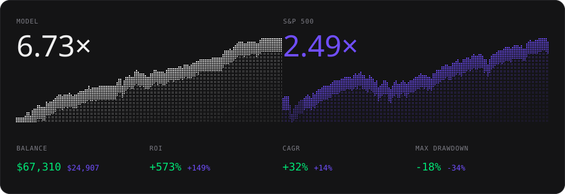
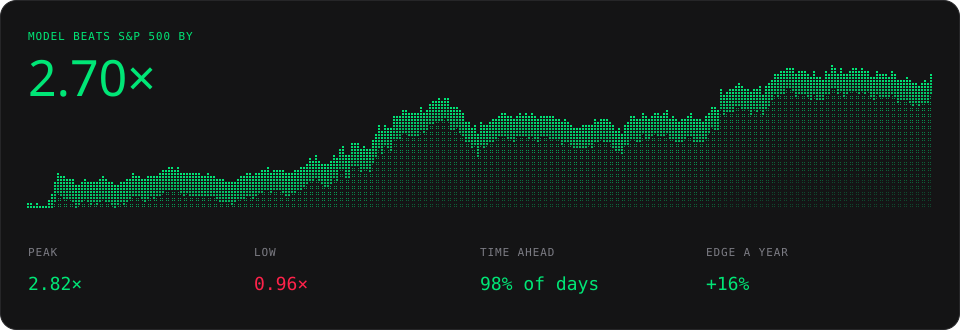
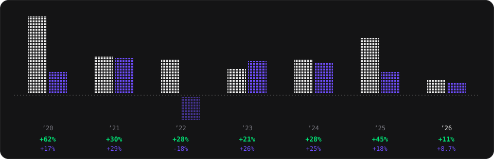
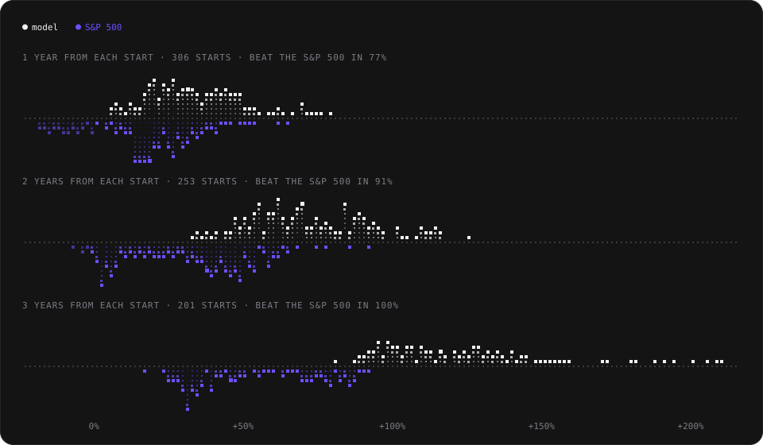
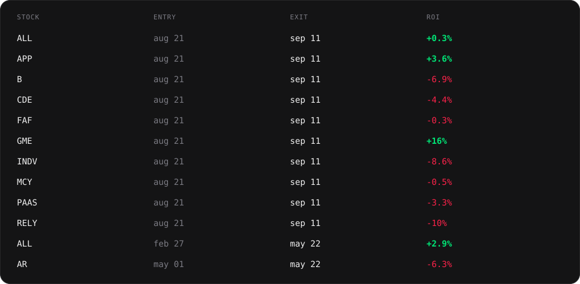

<h1 align="center">GARP Core 10</h1>

<p align="center">An open-source trading model based on GARP principles that runs in Claude or ChatGPT.</p>

<p align="center">
  <a href="https://tickerdb.com/go/claude/garp-core-10"></a>
  &nbsp;
  <a href="https://tickerdb.com/go/chatgpt/garp-core-10"></a>
</p>

<p align="center">Click a button above, or paste this into Claude in your browser (in ChatGPT, use the button above):</p>

```
Read https://tickerdb.com/run/garp-core-10 and follow its steps. Once it's set up, schedule a weekly check every Friday after 06:00 UTC that reads my model link and tells me only if the model bought or sold something.
```

<p align="center">No signup first and no API key to paste: the assistant gives you one link to approve (a free TickerDB account is created there if you are new), then shows you the model's record and checks it for you every week. Each check uses 5 TickerDB credits; the Free plan's 250 credits a month cover one daily check.</p>

<p align="center">
  Data: <a href="https://tickerdb.com">TickerDB</a>. Live record since activation: <a href="https://tickerdb.com/model/garp-core-10">tickerdb.com/model/garp-core-10</a>
</p>

<p align="center">
  
</p>

GARP Core 10 returned +573% over the backtest, outperforming the S&P 500's +149% and ending 2.7× its result.

## Stats

<p align="center">
  
</p>

| | Model | S&P 500 |
|---|---:|---:|
| Balance from $10,000 | $67,310 | $24,907 |
| ROI | +573% | +149% |
| CAGR | +32% | +14% |
| Max drawdown | -18% | -34% |

From Jan 2, 2020 to Nov 6, 2026, valued at every daily close, after a 0.1% cost each way. Dividends count as they were paid, idle cash earns T-bills (BIL), and the S&P 500 is SPY with dividends reinvested.

GARP Core 10 grew faster than the S&P 500 (+32% vs +14% a year), with a shallower worst fall (−18% vs −34%).

## Edge

<p align="center">
  
</p>

The model's balance over the S&P 500's, day by day: above 1× it was ahead.

| | |
|---|---:|
| Model beats the S&P 500 by | 2.70× |
| Peak | 2.82× (May 5, 2026) |
| Low | 0.96× (Feb 19, 2020) |
| Time ahead | 98% of days |
| Edge a year | +16% |

GARP Core 10 beat the S&P 500 by 2.7× and was ahead 98% of the time.

## Yearly ROI

<p align="center">
  
</p>

| Year | Model | S&P 500 |
|---|---:|---:|
| 2026 | +11% | +8.7% |
| 2025 | +45% | +18% |
| 2024 | +28% | +25% |
| 2023 | +21% | +26% |
| 2022 | +28% | -18% |
| 2021 | +30% | +29% |
| 2020 | +62% | +17% |

2026 runs to Nov 6, 2026. GARP Core 10 beat the S&P 500 in 6 of 7 years; its best year was 2020 at +62%.

## Rolling starts

We ran the model from every weekly start to Nov 6, 2026, to see whether the result depends on the start date.

<p align="center">
  
</p>

| Yearly return | Model | S&P 500 |
|---|---:|---:|
| Median start | +28%/yr | +16%/yr |
| Best start (Oct 26, 2023) | +34%/yr | +22%/yr |
| Worst start (Feb 2, 2023) | +23%/yr | +11%/yr |
| Starts that beat the S&P 500 | 100% of 253 | |

Starts with at least two years to run. Whichever week GARP Core 10 started, its yearly return to date ran between +23% and +34%, above the S&P 500's from every one of 253 starts.

## Holding periods

The return from every weekly start after a fixed 1, 2 and 3 years.

<p align="center">
  
</p>

| Held for | Model median | S&P 500 median | Beat S&P 500 | Starts |
|---|---:|---:|---:|---:|
| 1 year | +31% | +18% | 77% | 306 |
| 2 years | +69% | +37% | 91% | 253 |
| 3 years | +116% | +45% | 100% | 201 |

## Trades

<p align="center">
  
</p>

The 12 most recent; all 316 are in [`results/trades.csv`](results/trades.csv). Returns are after the 0.1% cost each way, dividends included. GARP Core 10 closed 316 trades: 60% won, and the average trade returned +6.4%.

## Rules

Decided once a week on Thursday's close, traded at the next open, normally Friday's. When Friday is a market holiday the trade waits for the next open (usually Monday); in a week with no Thursday session it decides on Wednesday's close.

1. **Universe.** Every US stock with a market cap of at least $1B and a median traded value of at least $5M over the last four decision days.
2. **Candidate.** `fundamentals_growth_zone` is `high_growth`, `fundamentals_free_cash_flow_zone` is `moderate_surplus` or `high_surplus`, `fundamentals_revenue_growth_direction` is not `deteriorating`, `fundamentals_pe_vs_sector_zone` is `discount` or `deep_discount`, and the stock has a `garp_core_score`.
3. **Hold the 10 candidates with the highest GARP Core score**, equal weight at entry. A slot with no candidate stays in BIL (T-bills).
4. **No stop losses.** A holding leaves only when a candidate scores at least 5 points higher than it (a holding that no longer passes the growth test counts as the lowest), when its growth zone turns `shrinking` or it starts burning cash, or when its P/E moves to a premium to its sector.
5. **Risk-off.** When `macro_yield_curve_zone` has been `flat` for three decision days in a row, sell everything and hold BIL. Come back the first week it is no longer flat.

The parameters are at the top of [`model.py`](model.py).

## Run it yourself

With Claude Code, Codex, Cursor or another agent that runs code on your computer, paste this to clone the model and run it there on a schedule:

```
Clone github.com/tickerdb/garp-core-10 and follow its README:
set up TickerDB using tickerdb.com/setup, then schedule run.py to run
every Friday at 05:00 UTC and tell me when it makes a trade.
```

## How the results are made

The figures above are the model's published record, the same one [its page](https://tickerdb.com/model/garp-core-10) shows: TickerDB runs these rules on its point-in-time data, marks the book at every daily close and publishes the result. [`readme.py`](readme.py) writes this README, its charts and `results/` from that record, and [`backtest.py`](backtest.py) replays the rules from the TickerDB API on its own and must make exactly the record's 316 trades.

```bash
export TICKERDB_API_KEY=tdb_...        # https://tickerdb.com/setup
python backtest.py                     # replays the rules on every US stock weekly since late 2019 (about 27,000 credits)
python backtest.py --offline           # reruns the replay on the cached data/
python readme.py                       # fetches the published record and rewrites the README, charts and results/
python readme.py --check               # fails if anything here differs from the record, or the replay's trades do
python run.py                          # this week's holdings
python -m unittest discover -s tests   # offline tests of the rules and the record
```

The replay needs a TickerDB plan with history from 2020 (Pro). No dependencies beyond Python 3.10+.

`run.py` costs about 125 credits a week (about 550 a month, more than the free plan's 250). It prints what to sell and buy, keeps the holdings in `state.json`, and never places orders.

Point in time: a week's decision uses only the daily snapshot of the week's last session from Monday to Thursday (knowledge cutoff 04:00 UTC the next day) and fills at the next session's open. Delisted companies stay in the history while they traded, and prices are matched by `asset_id`. A holding that stops trading is sold at its last close. Macro values are as first published.

## Caveats

- **In-sample.** The fields, the ranking, the 10 holdings and the risk-off rule were all chosen on the same 2020 to 2026 history they're tested on, so expect live results to be weaker. The rolling starts reuse that history; they show the result does not hinge on one start date, not that it holds out of sample.
- **The risk-off rule rests on a few flat-curve periods:** early 2020, February to July 2022, September 2024 to April 2025, and most of May to November 2026. It sat out 85 of 358 weeks.
- **2020 is flattered by timing.** The curve was already flat when the backtest starts, so the model sits out the Covid crash and buys in late March 2020.
- **Short history.** GARP Core scores start in 2020, so the backtest covers under seven years.
- **Coverage.** Only about half of $1B+ stocks carry a GARP Core score; the rest cannot be held.
- **Costs.** 0.1% each way, no extra slippage. Smaller stocks at the open may fill worse.
- **Delistings.** Companies delisted in 2019 and 2020 are still being completed in TickerDB, so early losers may be under-counted.
- **No sector limit.** The ten holdings can cluster in one sector.
- Not investment advice. A backtest shows how a model would have done in the past; it doesn’t predict future results.

## License

MIT. The fonts embedded in the README images (Oxanium, Inter, JetBrains Mono, in `assets/fonts/`) are under the SIL Open Font License 1.1.
